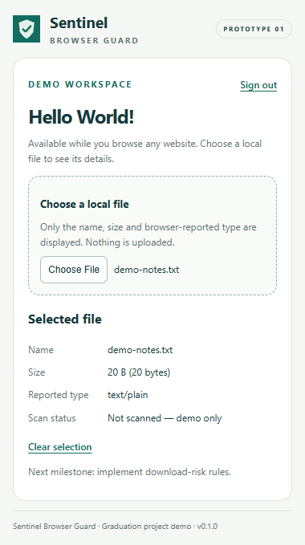

# Sentinel Browser Guard — Chrome Extension Demo

A graduation-project prototype built with Chrome Manifest V3, HTML, CSS and JavaScript. Open the toolbar popup while browsing any website to try a demo login and select a local file.

## Features

- Toolbar popup with a demo login screen.
- Hello World dashboard.
- Local file selection displaying the name, size and browser-reported MIME type.
- Remembered demo login state and a sign-out button.
- No backend, external API, build step or requested browser permissions.

## Install locally

1. Download this repository using **Code → Download ZIP**, then extract it.
2. Open `chrome://extensions` in Google Chrome.
3. Enable **Developer mode**.
4. Select **Load unpacked** and choose the extracted folder containing `manifest.json`.
5. Pin **Sentinel Browser Guard - Demo** from Chrome's extensions menu.
6. Browse to any website and click the extension icon.

For Arabic instructions, see [README_AR.md](README_AR.md).

## Try the demo

Click **Fill demo credentials**, then **Enter demo**. The intentionally public sample credentials are `demo@sentinel.local` / `demo123`; they are not a real account.

Choose a local file to display its metadata. The file is not uploaded, executed or scanned. The popup closes when focus moves away; selected files are not retained after the popup closes. Only the demo login state is remembered locally.

## Scope

This version demonstrates the extension interface. It does not inspect the current website, monitor downloads, detect malware or implement secure authentication. A browser-reported file type is not a verified security assessment.

## Source files

| File | Purpose |
| --- | --- |
| `manifest.json` | Extension definition and popup entry point |
| `popup.html` | Login and dashboard interface |
| `app.js` | Demo login and file metadata display |
| `styles.css` | Popup styling |
| `icons/` | Extension icons |

## Preview

